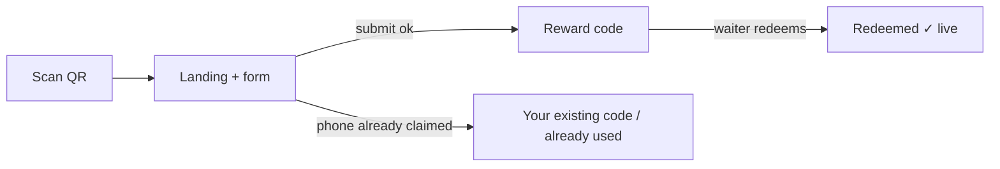

# Restaurant QR Loyalty — Design Spec v1.0

Owner: ui/ux designer · 2026-11-26 · Stack: Vite React + TS + Tailwind + shadcn/Radix.
All restaurant branding, copy and offers marked **[PH]** are placeholders. No real photos; the logo is a text wordmark placeholder.

## 0. Direction (one sentence)
**Warm bistro, zero friction.** The customer side feels like the restaurant's own warm, appetising page and gets them from scan to code in under 30 seconds on one screen. The staff side is a calm, neutral shadcn tool with the restaurant's colour used only as an accent, so the one product can be sold to any restaurant.

## 1. Sitemap
**Customer (public, no login)** at `/r/:slug`
- `/r/:slug`: landing with the form on the same screen.
- `/r/:slug/reward/:token`: the reward code screen. The token is saved in localStorage so a revisit reopens it.
- `/r/:slug` when the offer is off shows the "offer ended" state.

**Staff (login)** at `/admin`
- `/admin/login`
- `/admin/redeem`: the default after login, because waiters use this most.
- `/admin/contacts`
- `/admin/campaigns` and `/admin/campaigns/new` · `/admin/campaigns/:id`
- `/admin/qr`: printable table card.
- `/admin/settings`: restaurant name, logo, brand colour, reward text.

## 2. Tokens

### Brand (per restaurant, overridable: CSS vars on `:root[data-restaurant]`)
| token | default hex | use |
|---|---|---|
| `--brand` | `#B83A22` tomato [PH] | customer CTA, QR card band, staff accent |
| `--brand-fg` | `#FFFFFF` | text on brand (5.7:1) |
| `--brand-soft` | `#F8E3DC` | brand-tinted surfaces |

The settings page checks the brand colour against white text and refuses anything below 4.5:1 ("Too light for white text, pick a darker shade").

### Neutral (fixed)
| token | hex | use |
|---|---|---|
| `--bg` | `#FFF8EF` | customer page bg (cream) |
| `--surface` | `#FFFFFF` | cards, inputs |
| `--ink` | `#2B1D16` | text (15.4:1 on cream) |
| `--ink-muted` | `#6B5B52` | secondary text (6.1:1) |
| `--line` | `#EADFD3` | borders, dividers |
| `--gold` | `#F2C14E` | reward ticket accent; text on it is `--ink` |
| `--olive` | `#4F5D2F` | "consented" badge, success-ish accents |
| `--success` | `#1E7A46` | valid code, redeemed |
| `--warning` | `#B45309` | already used |
| `--danger` | `#B42318` | errors, not found (always shown with an icon + text, never colour alone) |

The staff app uses the shadcn `stone` neutral scale with `--primary = --ink`, so its buttons are espresso, not tomato. The brand colour shows up only on the active nav item and the logo there.

### Type
- **Headings:** Bricolage Grotesque 600/700, self-hosted woff2 with latin + latin-ext (Albanian ë/ç).
- **Body/UI:** Inter 400/500/600.
- **Reward code:** JetBrains Mono 700 with `tracking-[0.2em]`.
- Scale: `text-sm` 14, `text-base` 16 (inputs never below 16, so iOS doesn't zoom), `text-lg` 18, `text-2xl` 24, `text-4xl` 36, and the reward code at 40/48.

### Spacing / shape
- Spacing uses the Tailwind 4px scale. The customer page uses `px-5`, and sections use `gap-6`.
- Radius: cards `rounded-2xl`, inputs and buttons `rounded-xl`, badges `rounded-full`.
- Tap targets are at least 44px. Customer inputs are `h-12` and the primary CTA is `h-14`.
- Shadow: only `shadow-sm` on cards. The reward ticket gets `shadow-lg`.

## 3. Customer flow

### 3.1 Landing + form (`/r/:slug`), mobile first, max-w `md` centred on desktop
From top to bottom on one scroll, with the form starting above the fold on a 390×844 screen:
1. **Header** `h-14`: restaurant wordmark [PH] "Trattoria [PH]", centred. No nav.
2. **Offer block:**
   - eyebrow `text-sm` `--brand` "Welcome to [PH] Trattoria";
   - H1 `text-4xl` "Your first appetizer is on us" [PH];
   - one line `--ink-muted` "Leave your details and show the code to your waiter. Takes 20 seconds."
   - No hero photo, which keeps it fast and avoids photo placeholders. An illustrated plate icon is optional, as a placeholder.
3. **Form card** (`bg-surface rounded-2xl p-5`, label above each field):
   | field | control | rules |
   |---|---|---|
   | Name | Input `autocomplete="given-name"` | required, 1–60 |
   | Phone | country Select (default 🇦🇱 +355) + Input `type="tel" inputmode="tel" autocomplete="tel"` | required, valid E.164; this is the one-reward-per-person key |
   | Email | Input `type="email" autocomplete="email"` | required, valid email |
   | Birthday (optional) | two Selects, **Day** and **Month**, with no year | helper "So we can treat you on your birthday" |
   | Marketing consent | Checkbox, **unticked by default**, 24px box inside a `min-h-11` (44px) row; the whole row incl. label text is the `<label>`, tappable | label: "Send me offers from [PH] Trattoria by message or email. I can stop anytime." |
   - Under the CTA, in `text-xs` `--ink-muted`: "Your free appetizer doesn't depend on the box above. [Privacy notice] [PH]". The reward never requires consent, and the UI must make that obvious.
   - **CTA** full width `h-14 bg-brand text-brand-fg rounded-xl text-lg font-semibold`, labelled "Get my free appetizer" [PH].
4. **Footer** `text-xs`: "Powered by [PH product name]".

**Form states**
- Validation runs on blur and on submit. Errors show under the field in `--danger` `text-sm` with an AlertCircle icon, the field gets an `aria-invalid` red border, and focus jumps to the first error.
- Submitting: the CTA shows a spinner and the label "Getting your code…", and is disabled. Double-submit is blocked.
- Already claimed, **same device** (the original reward token is in localStorage): go straight to their full reward screen with the banner "Welcome back, you already have a reward" (or the redeemed/expired state).
- Already claimed, **any other device**: the **"Already claimed" card** (see 3.3). The full code is never shown there.
- Network/server error: an inline Alert above the CTA saying "Couldn't connect. Check your signal and try again." with a `Try again` button. Field values are kept.
- Rate-limited: "Too many tries, wait a minute and try again."
- Offer ended or restaurant inactive: the form is replaced with a card "This offer has ended. Thanks for visiting [PH] Trattoria."

### 3.2 Reward screen (`/r/:slug/reward/:token`)
- A **ticket card**, centred: a `--gold` top band with the text "FREE APPETIZER" [PH], a white body, and a perforated edge (a dashed divider with half-circle notches).
  - Line `text-lg` "Hi {name}, show this to your waiter"
  - **Code** `AB7K2Q`: JetBrains Mono 48px, 6 chars from `A–Z2–9` without 0/O/1/I. A `aria-label` spells it out.
  - **Live proof strip:** today's date + a ticking clock `HH:MM:SS` + a slow 3s shimmer across the ticket. This lets a waiter tell a live screen from a screenshot, and it's off under reduced motion while the clock still ticks.
  - Terms `text-xs`: "One per person · valid [PH: today / 30 days] · dine-in only [PH]"
- Below: "Keep this page open, or come back to this link anytime." with a `Copy link` button.
- **Redeemed state** (poll every 5s while visible, or on focus): the band turns `--success` with "ENJOYED ✓", the code gets struck through at 0.5 opacity, and the line says "Redeemed today at 19:42". It's announced via aria-live.
- **Expired:** the band turns `--ink-muted` with "EXPIRED" and the copy "This reward expired on {date}."
- Brightness hint: none, because we can't control it, and the code is large and high contrast anyway.

### 3.3 Already claimed (other device)
- Same cream page, a card with no gold ticket (so it can't be mistaken for a valid reward):
  - Icon TicketCheck in `--ink-muted`, H2 "You've already claimed this, {firstName}"
  - Masked code in mono `text-2xl` `--ink-muted`: `•••• K7` (last 2 chars only), plus a status word: "Not used yet" / "Used" / "Expired"
  - Body: "Open the page on the phone you claimed with, or ask your waiter. They can find your reward with your phone number."
- No retry CTA and no way to reveal the code. `data-testid="claim-already"`.

## 4. Staff app

### 4.1 Shell
- **Phone (<768):** a top bar `h-14` with the restaurant name and avatar menu (Settings, Log out), and a **bottom tab bar** `h-16` with 4 tabs: Redeem (TicketCheck) · Contacts (Users) · Campaigns (Megaphone) · QR card (QrCode). The active tab is `--brand` with a label always visible.
- **Desktop (≥1024):** a left sidebar `w-60` with the same items + Settings at the bottom, and content `max-w-5xl` with `p-8`.
- Every page header has an H1 `text-2xl` plus a one-line description in `--ink-muted`.

### 4.2 Login (`/admin/login`)
- A centred card `max-w-sm` with the wordmark, Email, Password (with a show/hide eye button), and a full-width `Log in` button.
- Errors:
  - wrong credentials: one generic message, "Email or password is wrong";
  - rate-limited: "Too many attempts. Try again in a few minutes."
- No sign-up. Accounts are made by us. "Forgot password?" shows the text "Ask [PH company] to reset it" (no email flow in v1).
- Session expired mid-use: redirect to login with the toast "You were logged out, log in again". Any unsaved campaign draft is kept in localStorage and restored.

### 4.3 Redeem (`/admin/redeem`), the waiter's main screen
- Big **6-box code input** (shadcn `InputOTP`, `h-14 w-12` boxes, mono 28px). Auto-uppercases and autofocuses, `inputmode="text" autocapitalize="characters"`. The code alphabet has no 0/O/1/I, so typing one shows "That character isn't used in codes".
- It submits automatically when 6 chars are entered, and there's also a `Check code` button.
- **Result card** (replaces the hint below the input):
  - **Valid:** `--success` left border 4px + a CheckCircle, then "Valid · {name}", "Claimed {relative time}", and a primary `Mark as used` button (`h-12`, full width on phone). Then:
    - **Done:** a big success state "Redeemed ✓ · {name}" + `Redeem another` (it also auto-resets after 6s).
  - **Already used:** `--warning` + an AlertTriangle, then "Already used {date, time} by {staff name}". There's no action.
  - **Not found:** `--danger` + an XCircle, then "No reward with that code. Check the letters with the guest." The input is kept and selected for retyping.
  - **Expired:** neutral, "Expired on {date}".
- There's no undo of a redeem in v1, so a confirm isn't needed either. It's one tap because the waiter is standing at the table. An admin-only "Undo redeem" lives in the contact detail.
- **Find by phone** (text link under the code input): a phone Input → shows the matching guest's reward as the same Result card, so a guest on a new phone can still be served. Staff only, rate-limited.
- Camera scanning is **not in v1**, because typing 6 chars is fast and avoids camera permissions.

### 4.4 Contacts (`/admin/contacts`)
- Toolbar:
  - search Input "Search name, phone or email" (debounce 300ms);
  - filter Selects for **Consent** (All / Consented / Not consented) and **Reward** (All / Not used / Used / Expired);
  - `Export CSV` (outline, Download icon), right-aligned.
- **Desktop:** a shadcn Table with columns Name · Phone · Email · Birthday (`12 Mar`) · Consent (an olive "Yes" badge or a muted "No") · Reward (badge) · Joined (date). Sort by Joined (default, newest) or by Name. Pagination 50 per page.
- **Phone:** a card list, with the name in bold and the reward badge on the right, then phone · joined, then the consent badge.
- **Row/card click** opens a Sheet (right on desktop, bottom on phone) with all fields, the reward code + status + history, and, for admins only, `Undo redeem` (AlertDialog: "Mark this reward as not used?").
- **Export:** exports the **current filter + search** and the button label says the count, "Export 128 contacts". The CSV includes a consent column and a consent timestamp. When the filter isn't "Consented", a small note shows under the button: "Includes people who didn't agree to marketing, so don't message them."
- **States:**
  - Empty (no contacts yet): an illustration placeholder + "No guests yet. Print your QR card to start." + `Go to QR card`.
  - No search results: "No one matches "{q}"." + `Clear search`.
  - Loading: 8 skeleton rows.
  - Error: an Alert with `Retry`.

### 4.5 QR card (`/admin/qr`)
- **Phone:** stacked; **desktop:** two columns, options on the left `w-80` and the live preview on the right.
- **Options:**
  - Headline (default "Scan for a free appetizer" [PH], max 40);
  - Small line (default "No app needed · 20 seconds", max 50);
  - Show logo (Switch);
  - Size: ToggleGroup **A6 card** (105×148mm, default) · **A5** · **Table tent** (A5 folded, two faces).
- **Card design:**
  - a `--brand` top band with the wordmark;
  - the headline in Bricolage `text-3xl` (for print, use pt sizes from §6);
  - a **QR at least 40mm**, black on white with a 4-module quiet zone and error correction M;
  - the short URL under the QR in mono `text-xs` (e.g. `[PH-domain]/r/trattoria`);
  - the small line.
  - Corners `rounded-2xl` in preview only, since print has no rounding guarantee.
- **Actions:**
  - `Print` (primary): a print stylesheet that hides the app chrome and sets `@page` to the chosen size;
  - `Download PNG` (300 dpi) and `Download PDF`;
  - `Copy link`.
- The preview shows a "Test it: scan with your phone" hint. The URL must point to this restaurant's slug.

### 4.6 Campaigns (`/admin/campaigns`)
- A **list** with rows: name · audience · status badge · updated. Statuses in v1:
  - **Draft** (muted);
  - **Ready** (olive). It's saved and complete, but sending isn't connected.
  - There's **no "Sent" status in v1**.
- The empty state says "No campaigns yet. Write your first promo." + `New campaign`.
- **New/edit** (on desktop, the form is on the left and the preview on the right; on phone, the preview sits under the form):
  - Name (internal, e.g. "Monday BOGO") [PH]
  - **Message** Textarea, 5 rows. The counter reads "92 / 160 characters", turning amber over 160 with "May be split into 2 messages" (provider-neutral wording). An insert chip, `{first name}`, adds a placeholder token.
  - **Audience** RadioGroup (cards, each one 44px+):
    - "Everyone who agreed to offers": its live count "38 people";
    - "Birthdays this week": its count, plus the date range "Mon 23 – Sun 29 Nov".
    - The helper under it is always visible: "Only guests who ticked the offers box are ever included." Both audiences are consent-only. There's no way to pick non-consented people.
  - **Preview:** a phone-style message bubble on a light grey thread with the sample name "Ana" [PH] filled into `{first name}` and the restaurant name as the sender. It's a generic bubble, not styled as WhatsApp or iMessage.
  - **Footer:** `Save draft` (outline) · **`Send`, disabled**, with its label replaced by "Sending not connected yet" and a Plug icon. A tooltip or tap note says "We'll turn this on once we pick WhatsApp or SMS." A small `Copy message` link sits next to it so staff can still use the text by hand.
  - Leaving with unsaved edits: an AlertDialog "Discard changes?". Drafts also autosave to localStorage.
  - Audience count 0: the warning "No one in this audience yet", while saving still works.

### 4.7 Settings (`/admin/settings`)
- Restaurant name, slug (read-only with copy), logo upload (PNG/SVG, max 1 MB, preview; it's optional and the wordmark is the fallback), brand colour (a hex input + swatch + the contrast check from §2), reward text (headline + terms), and an offer **On/Off** Switch.
- Saving gives the toast "Saved". Errors show inline.

## 5. Components (shadcn)
Button, Input, Label, Checkbox, Select, InputOTP, Card, Badge, Table, Sheet, Dialog/AlertDialog, Tabs/ToggleGroup, RadioGroup, Switch, Textarea, Tooltip, Toast (sonner), Skeleton, Alert, DropdownMenu, plus custom: `RewardTicket`, `QrCardPreview`, `MessagePreview`, `BottomTabBar`, `ResultCard`.

## 6. Print sizes (QR card)
At A6:
- headline 22pt Bricolage 700;
- small line 10pt Inter;
- URL 8pt mono;
- QR 45mm;
- brand band 18mm tall.

Colours print as solid fills, so set `print-color-adjust: exact`.

## 7. Accessibility + must-haves
- All text is at least 4.5:1, and every pair above was checked.
- Status is never shown by colour alone: every badge or result has an icon + a word.
- Focus ring is `ring-2 ring-offset-2` in `--ink` on cream and in `--brand` in staff.
- Customer page: no layout shift when errors appear (reserve `min-h-5` under fields), and no cookie banner unless the law owner says so.
- `prefers-reduced-motion` disables the shimmer and transitions.
- The customer page language is set per restaurant (`lang="sq"` or `en`). Copy keys are kept so Albanian strings can drop in. [PH] English copy for now.

## 8. Edge cases (for qa)
| case | behaviour |
|---|---|
| Same phone submits again | Show their existing reward (unused/used/expired), never a second code |
| Same email, different phone | Treated as the same guest (match on normalised phone **or** email) → show their existing reward |
| Same number, other format (`069…` vs `+35569…`) | Server normalises to `+355…`; same guest |
| Leaves the reward page and comes back | localStorage token reopens it; re-entering the phone on another device shows the masked "Already claimed" card, never the full code |
| Waiter redeems while the guest is looking | The guest screen flips to "Enjoyed ✓" within 5s |
| Two waiters redeem the same code at once | The second gets "Already used … by {first waiter}" |
| Offer switched off | The landing shows "offer ended"; existing unused codes still redeem until expiry [PH rule] |
| Session expires mid-redeem | Redirect to login, then return to `/admin/redeem` |
| Campaign Send tapped | Nothing sends; it's disabled with "Sending not connected yet" |

## 8b. Team decisions folded in (2026-11-26)
- **Phone is required**; matching is on normalised phone or email; a repeat claim shows the existing code, never a new one.
- **Birthdays this week** = Mon–Sun in Europe/Tirane; Feb 29 counts as Feb 28 in non-leap years. The audience card shows the exact range ("Mon 23 – Sun 29 Nov").
- **`noindex`** on `/r/:slug`, the reward page and all `/admin` pages.
- **Landing is its own chunk, under ~100 KB JS gzipped.** That's why the landing has no photos, no QR library, no table/chart code; fonts on the landing are only Bricolage 700 + Inter 400/600 (JetBrains Mono loads only on the reward screen, preload it after submit).
- Every field has a visible `<label>` (no placeholder-as-label), errors sit directly under their field with `aria-describedby`.
- **Repeat claim from another device** (no matching `deviceToken`): masked "Already claimed" card, `•••• N9`, never the full code. See §3.3. Status poll returns only unused/used/expired.
- Another restaurant's code in Redeem shows the same "No reward with that code" (back end returns 404).

## 9. Open for Drini (non-blocking, placeholders for now)
Placeholders still waiting on Drini:
- product name;
- the first restaurant's name, logo and colour;
- the reward wording and expiry rule;
- the privacy notice text and who writes it (legal, not design).
